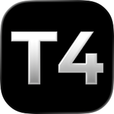

  

<h1 align="center">t4code</h1>

A personal fork of <a href="https://github.com/pingdotgg/t3code">T3 Code</a> with self-hosted connections and event routing.

  <a href="https://github.com/Royean/t4code/releases"><strong>Fork releases</strong></a> ·
  <a href="./docs/operations/fork-release.md">Build the fork</a> ·
  <a href="./docs/README.md">Docs</a> ·
  <a href="https://t3.codes">Upstream project</a>

  

t4code runs the coding agents on your machine and gives them one fast interface. Start a thread at your desk, then approve the next step from your phone.

It works with Claude Code, Codex, Cursor, OpenCode, Grok Build, Antigravity, Kiro, Pi, Muse Code, fx, and any [ACP](./docs/user/providers-acp.md) agent. If an agent is set up on your computer, t4code can control it.

## What you get

- **Your subscriptions.** t4code uses your existing subscriptions. It drives the agents you are already signed in to.
- **Every agent in one place.** Change models in the middle of a thread. Let Claude hand a task to Codex.
- **Desktop, web, and phone.** One server, and every client shows the same threads. There are apps for iOS and Android.
- **Remote ready.** Run agents on any machine. Connect over your local network, Tailscale, or [T3 Connect](./docs/user/remote-access.md).
- **Git built in.** Each thread can work in its own worktree. Review the diff, then commit, push, and open a pull request with one button.
- **Fast.** Performance is a feature here. We measure it, and we treat a dropped frame as a bug.
- **Open.** Source code is MIT licensed. If you don't like something, fork it under your own branding (see [Trademarks and forks](#trademarks-and-forks)).

## Install

Download the desktop installer for your platform, the standalone CLI archive, or the Android APK from [t4code releases](https://github.com/Royean/t4code/releases). The CLI archive contains the `t3` command. Run it to start the server and open the web client.

For local builds and platform-specific packaging details, see [Build t4code](./docs/operations/fork-release.md). To connect a phone to your computer, follow the [remote access guide](./docs/user/remote-access.md).

### Sign in to an agent

t4code needs one agent that is installed and signed in. For example, install [Claude Code](https://claude.com/product/claude-code) and run `claude auth login`, or install [Codex CLI](https://developers.openai.com/codex/cli) and run `codex login`.

[Provider setup](./docs/user/install.md#providers) has the steps for each agent. [Install T3 Code](./docs/user/install.md) covers nightly builds, AppImage, WSL, and NixOS.

## "Wait, what are you selling me?"

Nothing. We built T3 Code because we wanted the best possible development experience with agents. We were inspired by existing solutions like the Codex desktop app, Conductor, Claude Desktop and Cursor Glass, but none met our bar.

We wanted something performant, remote-ready, and truly open. If we ever go the wrong direction, we want you to have everything you need to fork the source code and build the tool that you want, under your own name and branding.

## Documentation

- [Install and first run](./docs/user/install.md)
- [Remote access from a phone or another machine](./docs/user/remote-access.md)
- [Permission modes](./docs/user/permission-modes.md)
- [Source control](./docs/user/source-control.md)
- [Connect outside agents over MCP](./docs/user/outside-agents.md)
- [FAQ](./docs/user/faq.md)

[All docs](./docs/README.md) has the full list.

## Contributing

We have limited review capacity. Small, focused fixes are the most likely to be merged. Features need an approved discussion first.

- Read [CONTRIBUTING.md](./CONTRIBUTING.md) before you report a bug or open a pull request.
- Put feature requests in [Ideas](https://github.com/pingdotgg/t3code/discussions/categories/ideas).
- Build from source with the [development runbook](./docs/operations/00_development.md#first-checkout). The [architecture overview](./docs/internals/01_architecture.md) explains how it works.
- Get help in [Discord](https://discord.gg/jn4EGJjrvv).

## License

The source code in this repository is licensed under the [MIT License](./LICENSE).

## Trademarks and forks

The MIT license applies **only to the source code**. It does not grant any rights to T3 Tools, Inc.'s trademarks, branding, or trade dress, including the **T3 Code** name, wordmark, logos, and application icons.

If you fork, redistribute, or build on T3 Code's source code:

- **Use your own branding.** Replace the T3 Code name, wordmark, logos, and application icons in any public fork, redistributed build, website, package, or app store listing.
- **Be explicitly clear that your project is unofficial.** Do not use the T3 Code name, wordmark, logo, or branding in your own projects without making it unmistakably clear that your project is unofficial and not affiliated with or endorsed by T3 Tools, Inc.

Using our name, wordmark, logo, or branding in a way that suggests official status or affiliation is trademark infringement and unlawful. **Any project indicating or implying that it is an official version of T3 Code when it is not will be pursued to the full extent of the law.**

See [TRADEMARK.md](./TRADEMARK.md) for the full trademark and branding policy.
